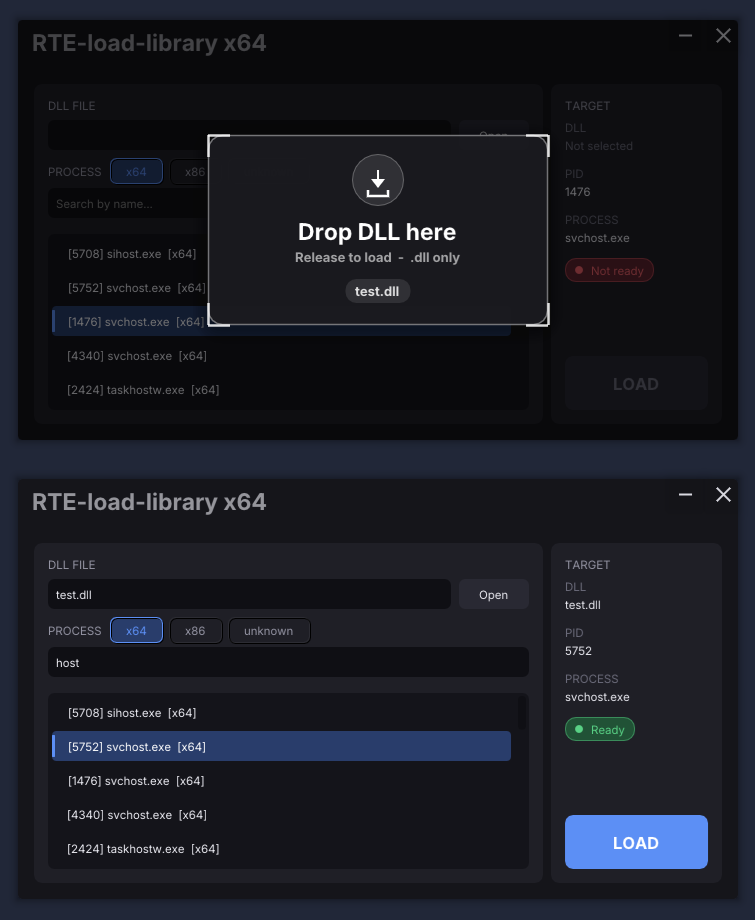

# RTE Load Library


**RTE Load Library** — это продвинутый инструмент для инъекции DLL в процессы Windows с графическим интерфейсом на базе ImGui и DirectX 11. Проект использует низкоуровневые методы внедрения через нативный API `NtCreateThreadEx`, обходя стандартные механизмы загрузки библиотек.

---

## 📋 Содержание

- [Основные возможности](#-основные-возможности)
- [Метод инъекции](#-метод-инъекции)
  - [Архитектура инжектора](#архитектура-инжектора)
  - [Пошаговый алгоритм](#пошаговый-алгоритм)
  - [Технические детали](#технические-детали)
- [Сборка](#-сборка)
- [Использование](#-использование)

---

## 🖼️ Скриншоты


---

## 🚀 Основные возможности

- **Современный GUI** на ImGui с поддержкой анимаций и кастомной отрисовки
- **Drag & Drop** поддержка DLL-файлов прямо в окно приложения
- **Выбор целевого процесса** из списка с фильтрацией по имени и архитектуре (x64/x86/unknown)
- **Асинхронная инъекция** — очередь задач обрабатывается в отдельном потоке
- **Уведомления о результате** с отображением кода ошибки
- **Шифрование строк** (`ENCSTR`) для сокрытия сигнатур
- **Поддержка Unicode** и кириллицы в интерфейсе

---

## 💉 Метод инъекции

### Архитектура инжектора

Проект реализует **manual mapping через удалённый вызов `LoadLibrary`** с использованием нативного API `NtCreateThreadEx`. Этот подход отличается от классического `CreateRemoteThread` и обеспечивает лучшую совместимость с защищёнными процессами.

```
┌─────────────────────────────────────────────────────────────┐
│                     CInjector::InjectDllByPid               │
├─────────────────────────────────────────────────────────────┤
│  1. Проверка: уже загружена? → GetModuleHandleEx            │
│  2. Проверка: файл существует? → manage_files::fileExists   │
│  3. OpenProcess(PROCESS_ALL_ACCESS)                         │
│  4. Патчинг NtOpenFile в целевом процессе                   │
│  5. VirtualAllocEx(MAX_PATH) для пути к DLL                 │
│  6. WriteProcessMemory(путь к DLL)                          │
│  7. GetProcAddressEx(kernel32.dll, "LoadLibraryW")          │
│  8. NtCreateThreadEx(LoadLibraryW, путь_к_DLL)              │
└─────────────────────────────────────────────────────────────┘
```

### Пошаговый алгоритм

#### 1. Проверка состояния (`IsDllInjected`)

Перед инъекцией выполняется проверка, не загружена ли уже целевая библиотека:

```cpp
bool CInjector::IsDllInjected(DWORD PID, const char* dllPath)
{
    HANDLE h_proc = OpenProcess(PROCESS_ALL_ACCESS, FALSE, PID);
    HMODULE hDll = GetModuleHandleEx(h_proc, dllName.c_str());
    // ...
    return hDll != 0;
}
```

Возвращаемые коды:

- `1` — DLL уже загружена
- `2` — файл не найден
- `3` — процесс не найден / нет доступа

#### 2. Патчинг `NtOpenFile`

Одна из ключевых особенностей — **временный патчинг `NtOpenFile`** в целевом процессе. Это делается для обхода возможных хуков антивирусов/античитов, которые могут перехватывать открытие файлов:

```cpp
const LPVOID nt_open_file = GetProcAddress(GetModuleHandle(TEXT("ntdll.dll")), "NtOpenFile");
if (nt_open_file)
{
    char original_bytes[5];
    memcpy(original_bytes, nt_open_file, 5);
    WriteProcessMemory(h_proc, nt_open_file, original_bytes, 5, nullptr);
}
```

> ⚠️ **Примечание:** В текущей реализации восстанавливаются оригинальные байты (фактически no-op), что может быть расширено до полноценного unhook-механизма.

#### 3. Выделение памяти и запись пути

```cpp
auto* loc = VirtualAllocEx(h_proc, nullptr, MAX_PATH, 
                           MEM_COMMIT | MEM_RESERVE, PAGE_READWRITE);
WriteProcessMemory(h_proc, loc, dll_path, len, nullptr);
```

#### 4. Разрешение адреса `LoadLibrary`

Используется кастомная реализация `GetProcAddressEx`, которая работает с **удалённым процессом** — читает PEB и экспорт-таблицы `kernel32.dll` через `ReadProcessMemory`:

```cpp
f_Routine* pLoadLibrary = reinterpret_cast<f_Routine*>(
    GetProcAddressEx(h_proc, TEXT("kernel32.dll"), LOAD_LIBRARY_NAME)
);
```

Это критически важно, так как адреса `LoadLibrary` в разных процессах могут отличаться из-за ASLR.

#### 5. Создание удалённого потока

Вместо классического `CreateRemoteThread` используется **`NtCreateThreadEx`** — нативная функция из `ntdll.dll`:

```cpp
using f_NtCreateThreadEx = NTSTATUS(__stdcall*)(
    HANDLE* pThreadHandleOut, ACCESS_MASK DesiredAccess, void* pAttr, 
    HANDLE hProc, void* pRoutine, void* pArg, ULONG Flags, 
    SIZE_T ZeroBits, SIZE_T StackSize, SIZE_T MaxStackSize, void* pAttrlistOut
);

NTSTATUS ntRet = p_NtCreateThreadEx(
    &h_thread, THREAD_ALL_ACCESS, nullptr, h_proc, 
    pLoadLibrary, loc, 0, 0, 0, 0, nullptr
);
```

**Преимущества `NtCreateThreadEx`:**

- Меньше детектируется античитами по сравнению с `CreateRemoteThread`
- Позволяет тонко настраивать параметры потока (стек, флаги)
- Нативный API, используемый самим загрузчиком Windows

### Технические детали

| Аспект | Реализация |
|--------|-----------|
| **API создания потока** | `NtCreateThreadEx` |
| **Разрешение адресов** | `GetProcAddressEx` (чтение PEB удалённо) |
| **Соглашение о вызовах** | `__fastcall` (x64) / `__stdcall` (x86) |
| **Шифрование строк** | `ENCSTR()` макрос |
| **Обработка очереди** | Отдельный поток с polling каждые 30 мс |
| **Асинхронность** | `InjectQueueHandler::AddToQueue()` → `Execute()` → `SetResult()` |

#### Очередь инъекций

Архитектура разделяет GUI-поток и поток-инжектор:

```cpp
// В отдельном потоке (thExtra):
while (!finished)
{
    CProcessManager::UpdateProcessList();
    int result;
    int id = InjectQueueHandler::Execute(result);
    if (id >= 0)
        InjectQueueHandler::SetResult(id, result);
    std::this_thread::sleep_for(std::chrono::milliseconds(30));
}
```

GUI вызывает `InjectQueueHandler::AddToQueue(pid, path)` и опрашивает `GetResult()` для отображения статуса.

---

## 🔨 Сборка

### Требования

- **Visual Studio 2019/2022** (или MSVC с поддержкой C++17)
- **Windows SDK 10+**
- **DirectX 11** (входит в Windows SDK)
- Подключённые зависимости: **Dear ImGui**, **GDI+**

### Команды

```bash
git clone --recursive <repo-url>
cd rte-load-library
# Откройте .sln в Visual Studio и соберите конфигурацию Release x64/x86
```

> Убедитесь, что архитектура вашего приложения совпадает с архитектурой целевого процесса (или используйте соответствующий метод для cross-arch инъекции).

---

## 🎮 Использование

1. Запустите `RTE-load-library.exe`
2. Выберите DLL-файл (кнопка **Open** или **перетащите** в окно)
3. Найдите целевой процесс в списке (фильтр по имени + архитектуре)
4. Нажмите **LOAD**
5. Дождитесь уведомления о результате:
   - ✅ `Library loaded successfully!`
   - ❌ `Unable to load library. Error code: <N>`

---
